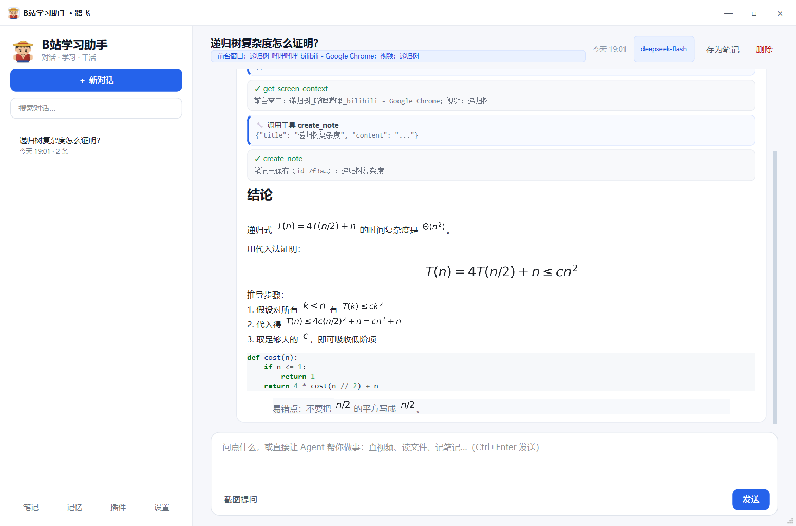
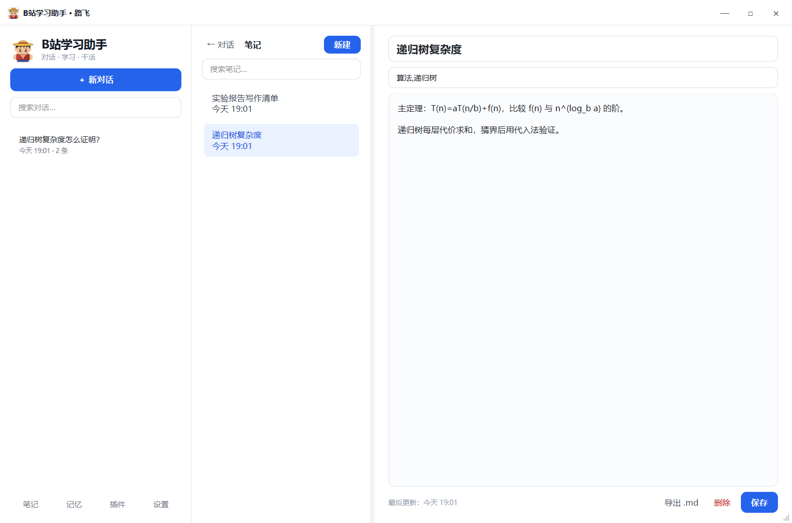
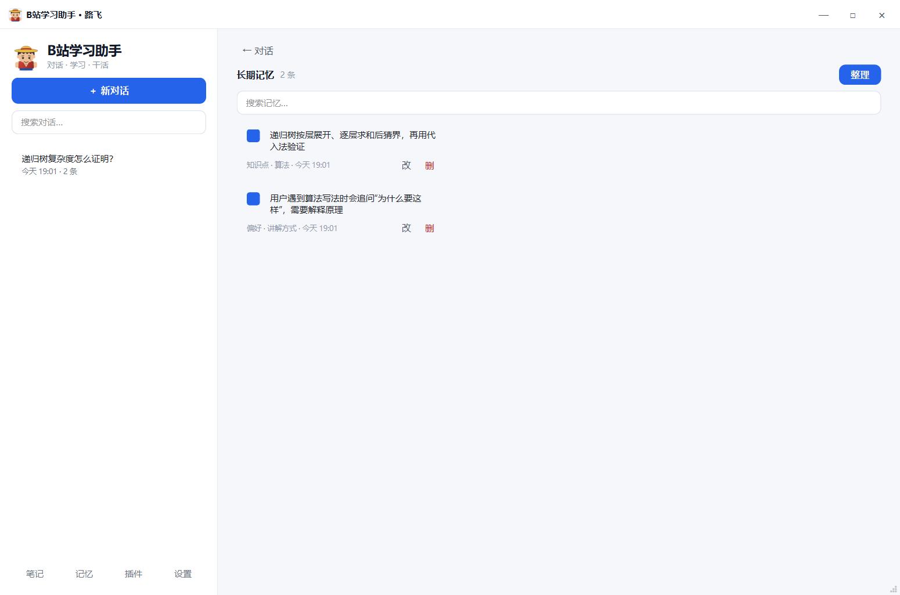

# Study-AI（B站学习助手）· 对话式 Agent 桌面版

一个长在桌面上的学习 Agent：**直接对话让它做事**，或双击路飞桌宠截图问视频内容。工具调用以卡片形式出现在对话里，笔记单独管理、随时可改。


## 对话即 Agent

- 在底部输入框直接说：**“查一下我现在看的视频讲了什么，整理成笔记”**
- 或双击桌宠 / `Ctrl+Alt+Q` 框选画面后提问
- Agent 会自动判断是否需要工具，并在回答前展示 **工具调用卡片**（工具名、参数、结果）
- 危险操作（写文件、插入 Word、打开程序）会弹窗确认
- 所有对话自动保存，工具步骤也会持久化，重新打开可回看
- **笔记页 / 记忆页左上角都有「← 对话」返回按钮**，按 `Esc` 也能回到对话
- 界面为浅色主题，无边框标题栏可拖动、最大化、关闭（关闭 = 最小化到托盘）



## 笔记（可视化、可编辑）

- 左侧会话栏底部点「笔记」，进入独立笔记页：列表 + 编辑器
- Agent 在对话里说“记到笔记里”时会调用 `create_note` 写入笔记库
- 助理回答右上角有「存为笔记」按钮，一键把该轮回答保存成笔记
- 标题、标签、正文随时修改；支持搜索、删除、导出 `.md`



## 把截图/图片插入 Word

1. 先打开 Word 文档，把光标放到要插入的位置
2. 对 Agent 说：**“把最近这张截图插到 Word，图注写‘图 1 递归树’”**
3. 弹出确认后允许执行

Agent 会自动调用：

| 工具 | 作用 |
| --- | --- |
| `get_word_status` | 查看当前 Word 文档和图片数量 |
| `insert_image_to_word` | 把指定图片（或最近截图）插入光标处 |
| `insert_screenshot_to_word` | 截当前屏幕并插入光标处 |
| `insert_clipboard_image_to_word` | 把剪贴板里的图片粘贴到光标处 |
| `insert_text_to_word` | 把一段文字插入光标处 |

需要本机安装 Microsoft Word（通过 COM 自动化，不会替换你正在编辑的文档；只插入到当前光标位置）。WPS 会尝试 `KWps.Application` 作为后备。

## 任务 Agent 能做什么

内置工具：

| 工具 | 作用 |
| --- | --- |
| `get_screen_context` | 读前台窗口/进程，识别 B 站视频名 |
| `get_bilibili_video` | 用链接或 BV 号查视频标题、UP 主、分 P |
| `get_current_time` | 当前时间 |
| `list_directory` / `read_text_file` | 列目录、读文本（读文件需确认） |
| `write_text_file` | 写文件（需确认） |
| `create_note` / `list_notes` | 写入/查看笔记库 |
| `insert_image_to_word` 等 | 插入图片/文字到 Word（需确认） |
| `open_path` | 打开文件/文件夹/网址（需确认） |
| `extract_bvid` | 从文本提取 BV 号 |

插件：`plugins/<name>/plugin.json` + `tool.py`，`tool.py` 里实现 `register(registry)`；也可以在「插件」里从文件夹或 zip 安装到 `data/plugins/`。插件是本地可执行代码，**只安装你信任的插件**。

> B 站网页接口有风控（412），所以视频识别优先用“前台窗口标题”，需要详细信息时让 Agent 用 BV 号/链接查询。后续会加浏览器扩展直接拿 URL 和字幕。

## 记忆

- 对话侧边栏底部「记忆」进入记忆库
- 「整理」会把最近的对话压缩成长期记忆并合并相似条目
- 每条记忆可启用/停用、编辑、删除；提问时按关键词自动筛出相关的几条注入上下文



## 快速开始

```powershell
pip install -r requirements.txt
python app.py
```

也可以双击 `start.bat`，或桌面快捷方式「B站学习助手·路飞 v3」。

首次使用在「设置」里填 DeepSeek API Key（https://platform.deepseek.com/api_keys 创建），也可用环境变量 `DEEPSEEK_API_KEY`。

## 热键

| 热键 | 作用 |
| --- | --- |
| `Ctrl+Alt+Q` | 截图提问 |
| `Ctrl+Alt+A` | 打开对话并聚焦输入框 |
| `Ctrl+Alt+H` | 打开主界面 |
| `Ctrl+Alt+S` | 设置 |
| `Ctrl+Alt+X` | 退出 |

关闭主窗口 = 最小化到托盘；退出用托盘菜单或 `Ctrl+Alt+X`。

## 桌宠

路飞风格（草帽 / 红背心 / 眼下疤痕），可拖动、右键菜单、全屏视频时自动隐藏；思考/完成/出错有表情。


> 桌宠是按路飞特征程序绘制的致敬形象，不使用官方素材。想换成自己的图片可以告诉我（请自备有使用权的图片）。

## 数据位置

```
Study-AI/
├── config.json                  # 配置（含 Key，已 gitignore）
├── data/
│   ├── bili_ask.db              # 会话 / 消息（含工具步骤 meta）/ 笔记 / 记忆
│   ├── captures/2026-10-17/….png# 截图原图
│   ├── math_cache/              # 公式渲染缓存
│   ├── plugins/                 # 用户安装的插件
│   └── app.log                  # 运行日志
├── plugins/study_notes/         # 内置示例插件
└── legacy/                      # 旧 Tk 版本，仅参考
```

## 测试

```powershell
# 50 项单元 + 交互流程测试（离屏，不弹窗）
python -m unittest discover -s tests -t . -v

# 真实 API 连通性（发合成图，产生极少量 token 费用）
python tests/live_api_check.py

# 重新生成文档截图（不弹窗、不抢焦点）
python tests/render_screenshots.py
```

回归覆盖：连续多次截图、取消框选、文字对话与追问、工具步骤持久化、笔记 CRUD、导航返回、记忆注入、空响应重试、桌宠双击、Word 工具注册。

## 常见问题

**热键没反应 / 被占用**
先试试桌宠双击、主界面按钮或托盘菜单；确认没有 QQ/输入法/录屏软件占用。

**B 站视频识别不到**
网页接口有风控，Agent 只能从前台窗口标题推断视频名。把视频链接或 BV 号直接发给它，可以调用 `get_bilibili_video` 查详细信息。

**截图黑屏**
优先用浏览器看 B 站，或关闭浏览器硬件加速。

**多显示器**
当前只截主显示器。

**回答为空 / 一直思考中**
默认已关闭深度思考；空响应会自动重试。如果仍为空，检查设置里的「深度思考」是否被打开，或调大 `max_tokens`。

**隐私**
截图只在唤起时抓一次，不做后台录屏；数据存本机。工具读取文件会确认，写文件/打开程序也会确认。

## 开发者文档

- [项目文件清单](docs/PROJECT_INVENTORY.md)：每个目录/文件的作用、公开与私有边界、备份说明
- [系统学习执行计划](docs/STUDY_PLAN.md)：8 周逐周任务、每日节奏、前 7 天安排、验收清单
- [整体代码框架](docs/CODE_FRAMEWORK.md)：分层图、启动流程、核心类、数据流、改功能对照表
- [架构说明](docs/ARCHITECTURE.md)：进程/线程模型、模块职责、数据流、数据库、扩展点
- [源码阅读指南](docs/READING_GUIDE.md)：阅读顺序、断点/调试、三条调用链、练习任务
- [系统学习路线](docs/LEARNING_PATH.md)：8 周计划、底层知识地图、官方文档与实验

## 下一步（按优先级）

- [ ] 浏览器扩展/本地桥：稳定拿到视频 URL、字幕、进度
- [ ] 更多工具：Word/WPS 插入截图与图注、Excel、浏览器查资料、Python 沙箱
- [ ] 笔记增强：Markdown 预览、双链、标签筛选、复习提醒
- [ ] B 站字幕抓取 + 最近 30 秒缓冲
- [ ] 本地音频转写（`faster-whisper`，RTX 4060）
- [ ] MCP 工具源支持
- [ ] 打包安装包、自动更新
